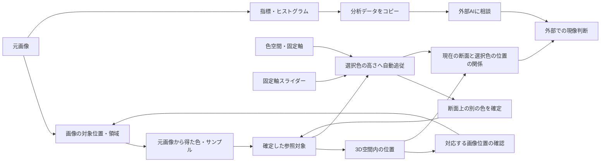
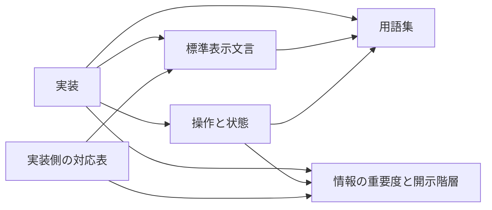

# Design: 写真の色を調べる作業の情報設計

状態: Draft。レイアウトと挙動は設計案であり、実装済みの説明ではない。
要求: [spec.md](spec.md)。根拠・未決事項: [notes.md](notes.md)。
情報の階層: [information-architecture.md](information-architecture.md)。操作と状態の正本: [state-transitions.md](state-transitions.md)。

本人の追加決定を反映: 選択時に自動追従、確定色は単一、スマホは縦並び、写真は自動で閉じない。
再解析で対象維持は不要、差し替え失敗では状態を変えない。コピー内容の再設計は対象外。

## 1. 出力形式

Markdownを正本とし、以下を組み合わせる。

| 形式                     | 明確にするもの                           |
| ------------------------ | ---------------------------------------- |
| 意図・行動・情報の対応表 | 利用者が何を判断するために操作するか     |
| Mermaidの情報関係図      | 写真、色、空間、断面、分析の意味上の関係 |
| Mermaidの状態遷移図      | 操作で何が変わり、何を保持するか         |
| イベント表               | 図に入りきらない条件、更新、例外、復帰   |
| 画面構成表               | 同じ作業を異なる画面幅でどう成立させるか |

単一のグラフに心理、配置、実装状態を詰め込まない。
後続のワイヤーフレームはこの仕様を具体的な配置へ落とすために作り、色・質感の評価とは分ける。

## 2. ユーザーのメンタルモデル

### 2.1 中心となる問い

「写真のこの部分の色はどこにあり、どの方向へ変えると、自分の欲しい色に近づきそうか」。
欲しい色のイメージは明確な場合と曖昧な場合がある。数値で目標色を入力することを必須にしない。
IroMapで得るものは現像判断の材料。具体的な現像パラメータとの対応や画像の編集効果を保証しない。

### 2.2 意図・行動・情報の対応（FR-1, FR-2, FR-7）

心理は本人の発言から整理した意図と、そこから導いた迷いの仮説。利用者全体を調査した結果ではない。

| 段階       | 本人の意図                           | 行動                                       | 迷いの仮説                   | その場で必要な情報                 |
| ---------- | ------------------------------------ | ------------------------------------------ | ---------------------------- | ---------------------------------- |
| 入力       | この写真を調べたい                   | 選ぶ／貼り付ける                           | 読み込めたか                 | 対象画像、処理状態、復帰方法       |
| 対象選択   | 現像で気になるのはここ               | 写真上の位置を選ぶ                         | 狙った位置が選べたか         | 写真上の印、元の色、対応点         |
| 位置把握   | この色は空間のどこか                 | 3Dを参照し、必要なら回転                   | 軸と色の位置関係             | 色空間、軸、選択点                 |
| 断面移動   | この色の周辺を見たい                 | 色を確定すると断面が自動で追従する         | 選択色を含む断面か           | 固定軸、断面値、選択色の位置       |
| 反復探索   | この方向へ動かしたらどうなるか       | 断面を動かし、3Dを見直す。別の色を確定する | 何が固定で何が変わったか     | 面内の軸、現在位置、現在の選択色   |
| 対象再確認 | この色は写真のどこか／別の点を見たい | 写真を表示し、必要なら点を選び直す         | 選択色に対応する箇所があるか | 対応位置、対応なしの区別、探索状態 |
| 補助分析   | 全体評価や相談の材料が欲しい         | 分析データを開き、コピーする               | 対象・条件が正しいか         | 指標、分布、対象、条件、コピー結果 |

主経路は写真 → 3D → 断面の往復。3Dの点から写真の対応箇所を見る逆経路も残す。
3Dの設定ボタンは低頻度でも、3D表示を見る頻度は高い。この違いを画面面積へ反映する。

## 3. 一枚の写真のライフサイクルと優先度

### 3.1 段階による優先度（FR-1, FR-6）

P1: 作業の中心。P2: 中心と併せて参照。P3: 要求したときに開く。
優先度は常設サイズと同義ではない。操作頻度と参照頻度も別の判断軸。

| 情報・操作                     | 入力前     | 対象選択中 | 反復探索中   | 補助分析中   |
| ------------------------------ | ---------- | ---------- | ------------ | ------------ |
| 写真入力・差し替え             | P1         | P3         | P3           | P3           |
| 写真の参照・点選択             | 入力例のみ | P1         | P2・要求時   | P2・対象確認 |
| 3D表示と選択点                 | P3         | P2         | P1           | P2・復帰先   |
| 断面と固定軸スライダー         | P3         | P2         | P1           | P2・復帰先   |
| 現在の選択色・選択元の最小情報 | P3         | P1         | P2・継続表示 | P2           |
| 色コード等の詳細               | P3         | P3         | P3           | P2           |
| 指標・ヒストグラム・コピー     | P3         | P3         | P3           | P1           |
| 3D表示設定                     | P3         | P3         | P3           | P3           |

一枚の作業中、入力は通常一度。写真の選び直しや入力失敗は例外として到達可能にする。
探索中に写真を小さくする案でも、現在の選択色に対応する画像位置と、画像に対応しない色を区別する。
前の選択色を基準色として保持する表示は作らない。

### 3.2 情報単位ごとの操作

操作と状態の正本は [state-transitions.md](state-transitions.md)。情報設計の同じ要素IDに対して、操作・前提・変更・保持・結果を定義する。
写真一枚のライフサイクルと断面の状態図は、各操作の連動を確認する補助図として同文書へ集約する。

## 4. 情報の関係と、操作の意味（FR-2, FR-3）

この図は情報の意味上の関係であり、クリックの順序や必須機能一覧ではない。
「外部AIに相談」は本人の現行作業を示す。アプリから自動送信する設計ではない。
分析データのコピー経路は既存機能への到達性だけを扱い、既定対象・書式・項目の再設計は対象外。
断面で色を確定すると選択元も更新する。写真由来の前の対象位置を、新しい色の位置として残さない。

### 4.1 混同しない状態

| 概念                 | 意味                                 | 保持・変更の規則案                                       |
| -------------------- | ------------------------------------ | -------------------------------------------------------- |
| 元画像               | 入力した写真                         | 空間・断面の操作で変更しない                             |
| 画像の対応位置・領域 | 現在の色・分析選択に対応する画像位置 | 選択元に応じて更新。対応しない色に古い位置を表示しない   |
| 確定した選択色       | クリック等で選んだ一つの色           | 別の色の確定で置き換え、自動追従する。前の色は保持しない |
| 一時参照色           | ホバー等で見ている色                 | 操作終了後は確定対象へ戻る                               |
| 断面条件             | 色空間、固定軸、値                   | スライダー等で変更。選択色の座標と区別                   |
| 断面で確定した色     | 面内で選んだ別の色                   | 新しい唯一の選択色になる。元の色と並べて保持しない       |
| 目標色・方向         | 本人が望む色のイメージ               | 入力必須にしない。自動提案は対象外                       |
| 分析対象範囲         | 指標の計算に使った範囲               | 選択色の表示と同じ範囲とは限らない                       |

ホバーと手動スライダー操作は確定色を変更しない。色の確定は写真・3D・断面で共通の置き換え操作。
画像を再解析した際に前の確定対象を維持する機能は要求しない。
単に断面上の色をクリックしただけで、「元画像のこの点を編集した」と表現しない。

### 4.2 断面の操作を分解する

1. 色を確定する: 固定軸の値を選択色の座標に自動で合わせる。
2. 固定軸スライダー: 別の位置の断面を見る。画像の色は変わらない。
3. 面内で参照・選択: 一時参照は選択を変えず、確定操作は新しい選択色へ置き換える。
4. 選択色の高さへ移動: 手動で離した断面を、現在の選択色の座標へ戻す。

スライダーの移動と、面内の縦横移動を同じ「色調整」と呼ばない。
各軸の名称・増減方向、選択色の位置、現在の断面位置を対応づけることが、方向理解の基礎になる。
方向別の色の並び、変化のプレビュー、目標色までの経路は将来候補として [notes.md](notes.md) に分離する。

## 5. 情報単位に結びつける状態設計（FR-3, FR-4）

[state-transitions.md](state-transitions.md) の要素別の操作一覧と操作定義を正本とする。
情報設計で定義した126要素を、操作のある要素と表示のみの要素へ分類する。

- 写真の点を選ぶ: 選択色と対応位置を更新し、断面を自動追従させる。写真は開いたまま。
- 3D・断面・色入力で確定する: 唯一の選択色へ置き換え、古い写真位置を引き継がない。
- 断面を動かす: 断面位置だけを変え、選択色と写真を保持する。
- 高さへ戻る: 現在の選択色を含む断面へ戻す。
- 詳細を開閉する: 探索条件を保ち、実際の入口へフォーカスを戻す。
- 写真を差し替える・再解析する: 成功時だけ結果を更新し、画像に属する選択を解除する。差し替え失敗・キャンセルでは作業状態を更新しない。

図・イベントの重複定義を置かず、変更時には対応する操作の契約を更新する。

## 6. 画面構成案（FR-5）

### 6.1 入力前と探索中を分ける

入力前: 画像を選ぶ／貼り付ける操作を中心に置く。
解析完了後: 入力操作を「画像を変更」へまとめ、観察へ移る。
対象選択中: 写真を選びやすい大きさで表示する。
探索中: 3D・断面・スライダーへ視線と操作を集中させる。

状態の変化のたびに全画面の配置を組み替えない。開閉・表示切り替えの限定された領域で優先度を変える。

### 6.2 表示領域別の案

| 条件           | 構成案                                                                                           | 作業上の利点                       | 検証する弱点                                           |
| -------------- | ------------------------------------------------------------------------------------------------ | ---------------------------------- | ------------------------------------------------------ |
| スマホ・狭い幅 | 3Dと断面を正方形に近い図として縦に並べ、スライダーを断面の直近に置く。写真はモーダル／シート候補 | タブ切り替えを繰り返さず往復できる | 画面高さ、縦スクロール、点選択・軸・タッチ領域の可読性 |
| 一般PC         | 3Dと断面を隣接表示し、断面の直近にスライダー。写真は展開可能な領域                               | 高頻度の往復を近づける             | 写真から点を選ぶ際の面積、結果との対応                 |
| 広い画面       | 中央に3Dと断面をまとめ、写真・分析を補助領域へ展開できる                                         | 主作業の距離を保ちつつ文脈を併記   | 画面端への操作分散、広げすぎた視線距離                 |

4K・ウルトラワイドは物理解像度だけで判定しない。ブラウザの表示幅、高さ、拡大率、入力方法を見る。
広い幅でも主作業を両端へ引き離さない。追加の幅を3Dの無制限な拡大だけに使わない。
タッチとマウスは画面幅と独立した条件として扱う。
比較用の幅は320／390／768／1280／1920／2560 CSS px、200%拡大を候補とし、実際の本人の環境で補う。
正方形に近い寸法は図の描画領域に適用し、ラベル・スライダーまで正方形に押し込めない。
二つの図が一画面へ収まるとはまだ保証しない。描画領域の正方形維持と、ラベル・操作の高さを実際の端末で確認する。
図の回転・選択・スライダー操作とページの縦スクロールが競合するため、操作領域とジェスチャーの分担をワイヤーフレームで検証する。

### 6.3 写真を一時表示する場合の規則

- 画像は入力後も保持し、写真の再入力なしに開ける。
- 選択中の対応位置を表示する。点の選択では閉じず、利用者が明示的に閉じる。
- タッチで選択位置を確認でき、閉じる前に誤選択を修正できる。
- 閉じる／戻る操作で回転・断面値を保持する。フォーカスを開いた操作へ戻す。
- 3D点から写真の対応を見る経路を残す。複数箇所がある場合、一点に断定しない。
- ファイル選択が開いた時点ではモーダルを閉じない。画像の入力と写真上の対象選択を別の完了イベントとして扱う。

## 7. 用語・表示文言の正本（FR-7）

概念と名前は [glossary.md](glossary.md)、表示する文字列と変数は [ui-copy.md](ui-copy.md) に従う。
この文書や状態設計で別の表示名候補を確定しない。

依存方向は「実装 → 設計の正本」。設計文書間では、情報・状態・表示文言が用語集の意味を参照する。

矢印は参照・依存する方向を示す。

[implementation-map.md](implementation-map.md) は設計IDと実装のパス・辞書キーを結ぶ下流の照合資料。既存表示やコードの改名で標準を自動的に変えない。
実装との差分は実装側の未反映として報告し、設計先行期間は許容する。

## 8. 後続のデザインシステムへの入力

- 状態別の情報優先度と、画面の主作業領域。
- 唯一の確定色／一時参照／面外の点／対応なしを区別する表現。
- 3Dと断面の対応、軸・スライダー・現在値の近接規則。
- 写真／分析の補助パネル、明示的な開閉、スマホの縦並びの挙動。
- 初回入力と、解析後の画像変更操作の違い。
- 正常・空・更新中・失敗・対応なし・利用不可の状態。

色、書体、余白、角丸、透過の値は、これらの作業条件を満たす画面で評価する。
そのため、今回の状態設計がデザインシステムの入力になり、後から見た目だけを貼り付ける構成にはしない。

## 9. 現段階の限界とレビュー

ワイヤーフレームと実操作の検証は未実施。視覚品質を承認済みとは扱わない。
次の設計では、スマホの正方形に近い縦並びと、PCの隣接表示を具体化する。
受け入れシナリオは [test-cases.md](test-cases.md) に記載し、主経路から順に確認する。

### 9.1 フローの監査結果

| 確認した経路                                       | 文書上の結果                                         |
| -------------------------------------------------- | ---------------------------------------------------- |
| 初回入力 → 選択 → 自動追従 → 手動探索 → 高さへ戻る | 到達・反復・復帰の経路あり                           |
| 断面で新しい色を選ぶ → 3Dを見る → 写真の対応を確認 | 選択色の置き換えと、対応なしの扱いを補完             |
| 写真で点を選び直す → 写真を閉じる                  | 点選択は写真確認状態内の操作。閉じるまで写真を保持   |
| 選択せず観察 → 写真・分析を開閉                    | 未選択でも到達でき、実際の起点へ戻る                 |
| 手動探索中 → 別の色を確定                          | 新しい選択へ自動追従。以前の断面や基準色を保持しない |
| 画像再解析 → 再選択                                | 成功時に解除し、概要へ戻る。再描画とは区別           |
| 差し替え失敗・キャンセル                           | 状態を変えず作業を継続                               |
| 確認を終える／別の写真へ進む                       | 作業の終了と差し替え成功の経路あり                   |

主要経路の行き止まりと、今回の決定に反する遷移は文書上で修正した。
残る設計判断は表示名称の理解の検証、空間／固定軸変更時の自動整合、スマホの操作領域と写真の表示方式。
実機の使いやすさ、ジェスチャー競合、図が同時に見える範囲は未検証。
