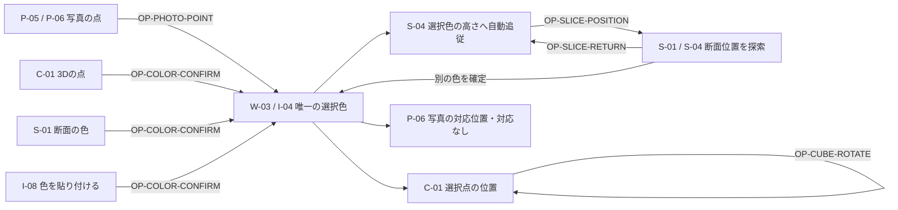
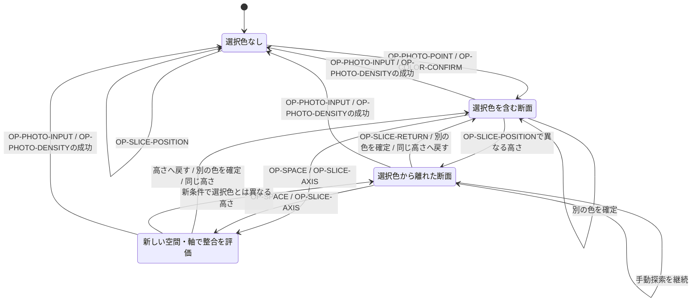
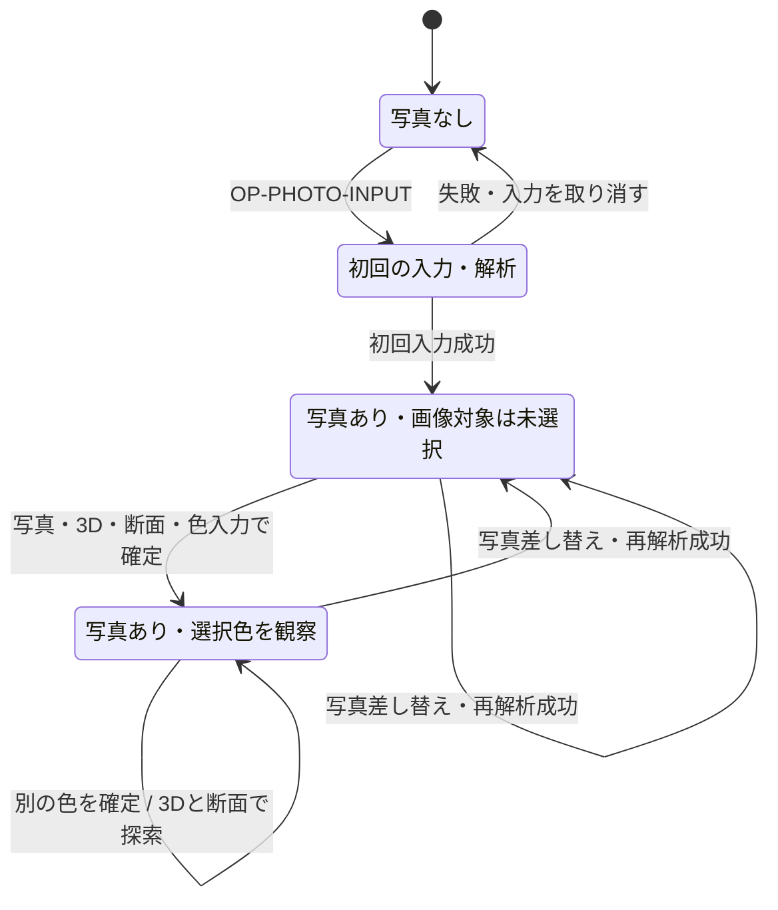

# 情報単位ごとの操作と状態

状態: Draft。今回のデザインPRの対象。操作と状態の正本として、実装はこの定義に従う。
関連: [情報の重要度と開示階層](information-architecture.md)、[用語集](glossary.md)、[標準表示文言](ui-copy.md)、[要求](spec.md)。

## 1. 読み方と依存方向

- 情報設計の要素IDを操作の対象として使う。各要素には操作、または「表示のみ」の分類がある。
- 「前提」「変更」「保持」「結果」が操作の契約。複数の図が連動しても、利用者の一回の操作として記述する。
- 同じ操作を各表示要素で再定義しない。表示側は共通の操作を参照する。
- 写真、選択色、断面位置、視点、開示状態は別の状態。これらを一つの排他的な画面状態へまとめない。
- 用語の意味はglossary.md、実際の文言はui-copy.mdに従う。ここに別の表示名を決めない。
- 実装済みであることを意味しない。判断区分に未確定の規則を明記し、本人の決定とは分ける。
- 情報設計のMarkdownには状態遷移を追加しない。この文書で同じ要素IDに結びつける。
- ブラウザやOSのファイル選択、ページ移動、外部の現像・AI相談はアプリ内の新しい状態・機能として定義しない。

## 2. 全情報単位と操作の対応

各行の操作IDから、操作の条件と結果を読める。表示のみの要素も省略しない。

| 情報単位 | 内容                            | 操作                             |
| -------- | ------------------------------- | -------------------------------- |
| W-00     | 作業画面の共通情報              | OP-VIEW（表示のみ）              |
| W-01     | 画面タイトルと説明              | OP-VIEW（表示のみ）              |
| W-02     | テーマ                          | OP-THEME                         |
| W-03     | 選択色の最小情報                | OP-PHOTO-POINT                   |
| P-00     | 写真                            | OP-PHOTO-INPUT                   |
| P-01     | 写真を選ぶ                      | OP-PHOTO-INPUT                   |
| P-02     | 画像を貼り付ける入力欄          | OP-PHOTO-INPUT                   |
| P-03     | 写真の参照入口                  | OP-PHOTO-OPEN                    |
| P-04     | 写真の参照領域                  | OP-PHOTO-OPEN                    |
| P-05     | 対象写真と代替情報              | OP-PHOTO-POINT                   |
| P-06     | 写真上の点の目印                | OP-PHOTO-POINT                   |
| P-07     | 写真上の領域の枠                | OP-PHOTO-RANGE                   |
| P-08     | 写真を閉じる操作                | OP-PHOTO-OPEN                    |
| P-09     | 写真の表示設定入口              | OP-DETAILS                       |
| P-10     | 写真の表示設定                  | OP-DETAILS                       |
| P-11     | サンプリンググリッド            | OP-PHOTO-GRID                    |
| P-12     | グリッド線の色                  | OP-PHOTO-GRID                    |
| P-13     | サンプリング密度                | OP-PHOTO-DENSITY                 |
| P-14     | 画像情報の入口                  | OP-DETAILS                       |
| P-15     | 画像情報                        | OP-DETAILS                       |
| P-16     | ファイルと解析情報の値          | OP-VIEW（表示のみ）              |
| C-00     | 3Dキューブ                      | OP-VIEW（表示のみ）              |
| C-01     | 3D図                            | OP-COLOR-CONFIRM、OP-CUBE-ROTATE |
| C-02     | 3D図の短い説明                  | OP-VIEW（表示のみ）              |
| C-03     | 色空間                          | OP-SPACE                         |
| C-04     | 軸とスライス位置の文脈          | OP-CUBE-ROTATE                   |
| C-05     | 3Dの表示設定入口                | OP-DETAILS                       |
| C-06     | 3Dの表示設定                    | OP-DETAILS                       |
| C-07     | 表示内容                        | OP-CUBE-CONTENT                  |
| C-08     | 写真の点を表示                  | OP-POINTS                        |
| C-09     | 選択範囲の点を表示              | OP-POINTS                        |
| C-10     | 軸ガイド                        | OP-CUBE-GUIDES                   |
| C-11     | 図のサイズ                      | OP-CUBE-SIZE                     |
| C-12     | 描画の補足情報                  | OP-VIEW（表示のみ）              |
| S-00     | スライス                        | OP-VIEW（表示のみ）              |
| S-01     | 断面図                          | OP-COLOR-CONFIRM                 |
| S-02     | スライスの短い説明              | OP-VIEW（表示のみ）              |
| S-03     | 固定軸                          | OP-SLICE-AXIS                    |
| S-04     | 固定値とスライダー              | OP-SLICE-POSITION                |
| S-05     | 断面の縦横の軸                  | OP-VIEW（表示のみ）              |
| S-06     | 選択色の高さへ移動              | OP-SLICE-RETURN                  |
| S-07     | スライスの表示設定入口          | OP-DETAILS                       |
| S-08     | スライスの表示設定              | OP-DETAILS                       |
| S-09     | 写真の点を表示                  | OP-POINTS                        |
| S-10     | 選択範囲の点を表示              | OP-POINTS                        |
| I-00     | 色の数値                        | OP-DETAILS                       |
| I-01     | 色の数値を開く入口              | OP-DETAILS                       |
| I-02     | カーソル位置の色                | OP-COLOR-HOVER                   |
| I-03     | カーソル位置の値と色見本        | OP-COLOR-HOVER                   |
| I-04     | 選択色の数値                    | OP-COLOR-CONFIRM                 |
| I-05     | HEXの値とコピー                 | OP-COLOR-COPY                    |
| I-06     | rgb()の値とコピー               | OP-COLOR-COPY                    |
| I-07     | hsl()の値とコピー               | OP-COLOR-COPY                    |
| I-08     | 色を貼り付ける                  | OP-COLOR-CONFIRM                 |
| A-00     | 補助分析                        | OP-DETAILS                       |
| A-01     | 分析表の入口                    | OP-DETAILS                       |
| A-02     | 分析表の構造                    | OP-DETAILS                       |
| A-M01    | 平均明度（L\*）                 | OP-VIEW（表示のみ）              |
| A-M02    | 明度のばらつき（L\*）           | OP-VIEW（表示のみ）              |
| A-M03    | 明度の95パーセンタイル（L\*）   | OP-VIEW（表示のみ）              |
| A-M04    | 緑・赤の偏り（a\*平均）         | OP-VIEW（表示のみ）              |
| A-M05    | 青・黄の偏り（b\*平均）         | OP-VIEW（表示のみ）              |
| A-M06    | 平均クロマ（C\*）               | OP-VIEW（表示のみ）              |
| A-M07    | クロマの95パーセンタイル（C\*） | OP-VIEW（表示のみ）              |
| A-M08    | 無彩色からの距離（平均）        | OP-VIEW（表示のみ）              |
| A-M09    | ハイライトの緑・赤の偏り        | OP-VIEW（表示のみ）              |
| A-M10    | ハイライトの青・黄の偏り        | OP-VIEW（表示のみ）              |
| A-M11    | ハイライトの無彩色からの距離    | OP-VIEW（表示のみ）              |
| A-03     | 分析表のコピー操作              | OP-DATA-FORMAT                   |
| A-04     | コピーの書式                    | OP-DATA-FORMAT                   |
| A-05     | 分析表をコピーする              | OP-DATA-COPY                     |
| A-06     | 写真分析の入口                  | OP-DETAILS                       |
| A-07     | 全体の色の傾向                  | OP-VIEW（表示のみ）              |
| A-08     | 色相バランス                    | OP-VIEW（表示のみ）              |
| A-09     | 彩度傾向                        | OP-VIEW（表示のみ）              |
| A-10     | 色面積比                        | OP-VIEW（表示のみ）              |
| A-11     | 色面積比の各行                  | OP-VIEW（表示のみ）              |
| A-12     | 明度ヒストグラム                | OP-VIEW（表示のみ）              |
| A-12-G   | 棒グラフと軸                    | OP-VIEW（表示のみ）              |
| A-14     | 色相ヒストグラム                | OP-VIEW（表示のみ）              |
| A-14-G   | 棒グラフと軸                    | OP-VIEW（表示のみ）              |
| A-16     | 彩度ヒストグラム                | OP-VIEW（表示のみ）              |
| A-16-G   | 棒グラフと軸                    | OP-VIEW（表示のみ）              |
| A-18     | Lab a\*-b\*散布図               | OP-VIEW（表示のみ）              |
| A-19     | 散布図の点と軸                  | OP-VIEW（表示のみ）              |
| A-20     | ヒストグラムのコピー            | OP-DATA-COPY                     |
| A-21     | ヒストグラムをコピーする        | OP-DATA-COPY                     |
| F-00     | 案内と結果の文言                | OP-VIEW（表示のみ）              |
| F-01     | 画像がないときの案内            | OP-PHOTO-INPUT                   |
| F-02     | 画像処理の案内                  | OP-PHOTO-INPUT                   |
| F-03     | 画像貼り付けの案内              | OP-PHOTO-INPUT                   |
| F-04     | 色のコピー・貼り付けの結果      | OP-COLOR-COPY                    |
| F-05     | 選択と分析コピーの短い通知      | OP-DATA-COPY                     |
| F-06     | 通知容器                        | OP-VIEW（表示のみ）              |
| X-00     | APIの分析確認画面               | OP-VIEW（表示のみ）              |
| X-01     | API画面の題名と説明             | OP-VIEW（表示のみ）              |
| X-02     | 入力の見出しと対応形式          | OP-VIEW（表示のみ）              |
| X-02-F   | API確認用の画像入力             | OP-API-INPUT                     |
| X-02-S   | API分析の実行ボタン             | OP-API-SUBMIT                    |
| X-02-I   | API確認用の写真プレビュー       | OP-API-INPUT                     |
| X-03     | 結果カードの文脈                | OP-API-SUBMIT                    |
| X-04     | 画像の大きさ                    | OP-VIEW（表示のみ）              |
| X-05     | 画像の色空間                    | OP-VIEW（表示のみ）              |
| X-06     | 明るさの平均                    | OP-VIEW（表示のみ）              |
| X-06-S   | 彩度の平均                      | OP-VIEW（表示のみ）              |
| X-07     | 説明文                          | OP-VIEW（表示のみ）              |
| X-08     | 主要色の各項目                  | OP-VIEW（表示のみ）              |
| X-09     | 可視化の説明                    | OP-VIEW（表示のみ）              |
| X-10     | 説明の各項目                    | OP-VIEW（表示のみ）              |
| D-00     | APIの説明画面                   | OP-VIEW（表示のみ）              |
| D-01     | APIの題名と説明                 | OP-VIEW（表示のみ）              |
| D-02     | エンドポイント                  | OP-VIEW（表示のみ）              |
| D-03     | リクエストの条件                | OP-VIEW（表示のみ）              |
| D-04     | リクエストの例                  | OP-VIEW（表示のみ）              |
| D-05     | レスポンスの説明                | OP-VIEW（表示のみ）              |
| D-06     | レスポンスの例                  | OP-VIEW（表示のみ）              |
| D-07     | エラーコードの説明              | OP-VIEW（表示のみ）              |
| D-08     | アクセス回数の制限              | OP-VIEW（表示のみ）              |
| R-00     | APIのHTML結果                   | OP-VIEW（表示のみ）              |
| R-01     | 結果の題名                      | OP-VIEW（表示のみ）              |
| R-02     | 解析概要の項目                  | OP-VIEW（表示のみ）              |
| R-03     | 分析の説明と所見                | OP-VIEW（表示のみ）              |
| B-00     | 表示を支える共通要素            | OP-VIEW（表示のみ）              |
| B-01     | 読み上げとフォーカスの情報      | OP-VIEW（表示のみ）              |
| B-02     | 図と情報の容器                  | OP-VIEW（表示のみ）              |
| B-03     | ブラウザタブの名前と説明        | OP-VIEW（表示のみ）              |

## 3. 操作の定義

### OP-PHOTO-INPUT 写真を入力・差し替える

- 対象要素: P-00、P-01、P-02、F-01、F-02、F-03。
- 操作: 画像を選ぶ／画像を貼り付ける。
- 前提: 入力の入口に到達できる。差し替え時には現在の写真と作業がある。
- 変更: 成功時だけ写真と解析結果を反映し、画像に属する選択色・対応位置・分析範囲を解除する。
- 保持: 差し替えの失敗・キャンセルでは現在の写真、結果、選択色、回転、断面、開閉、表示位置をすべて保持する。
- 結果: 初回成功／差し替え成功 → 写真あり・画像対象は未選択。初回失敗 → 写真なしで再入力できる。差し替え失敗・キャンセル → 現在の作業のまま。
- 連動: P-05とP-16は成功した対象を表示。初回の案内はF-01〜F-03。差し替え失敗用の状態・追加通知は作らない。
- 判断区分: 本人の決定と既存機能に基づく設計。

### OP-PHOTO-OPEN 写真を開く・閉じる

- 対象要素: P-03、P-04、P-08。
- 操作: 写真を開く／明示的に閉じる。
- 前提: 入力済みの写真がある。
- 変更: 写真の開示状態とフォーカス。開く入口のフォーカス位置を記録し、閉じたときに戻す。
- 保持: 選択色、写真上の対応位置、3D回転、断面位置、他の詳細の開閉。
- 結果: 閉 → 開／開 → 閉。写真上の点の選択では開いたまま。
- 連動: PCでは領域を展開、スマホではシート等を候補にする。3Dとスライスを別のページへ移さない。
- 判断区分: 本人の決定と既存機能に基づく設計。

### OP-PHOTO-POINT 写真の点を選ぶ

- 対象要素: P-05、P-06、W-03。
- 操作: 写真内の気になる点を確定する。
- 前提: 写真が入力済みで参照領域を開いている。
- 変更: 唯一の選択色と写真由来の対応位置。断面位置を選択色の固定軸座標へ合わせる。
- 保持: 写真の開いた状態、元画像、3D回転、表示設定。前の選択色は比較枠として保持しない。
- 結果: 未選択／選択済み → 新しい選択色あり・その色を含む断面。
- 連動: C-01に点を示し、S-01・S-04・S-06を連動させる。写真は自動で閉じない。
- 判断区分: 本人の決定と既存機能に基づく設計。

### OP-PHOTO-RANGE 写真の分析範囲を選ぶ

- 対象要素: P-07。
- 操作: 領域をドラッグして確定する。
- 前提: 写真を参照できる。
- 変更: 分析対象範囲と範囲の枠。
- 保持: 元画像、回転、断面の手動操作。領域の確定を単一色の確定と同一視しない。
- 結果: 範囲なし／範囲あり → 新しい分析範囲。
- 連動: A-00の対象範囲、C-09とS-10の範囲内の点に反映。領域選択が選択色を決めるかは既存機能との差分確認が必要。
- 判断区分: 既存の領域選択を継承。選択色との結合規則は未確定。

### OP-PHOTO-GRID 写真のグリッドを設定する

- 対象要素: P-11、P-12。
- 操作: グリッドを表示／非表示にする。線の色を白／黒から選ぶ。
- 前提: 写真の表示設定を開いている。
- 変更: グリッドの開示状態と線の色。
- 保持: 写真、サンプル、解析結果、選択色、3D回転、断面。
- 結果: 選んだ表示設定で写真を参照できる。
- 連動: 写真上の点を読む補助表示だけに反映。解析の条件変更とは区別する。
- 判断区分: 本人の決定と既存機能に基づく設計。

### OP-PHOTO-DENSITY サンプリング密度を変更する

- 対象要素: P-13。
- 操作: 密度を動かして確定する。
- 前提: 写真があり、設定を開いている。
- 変更: 操作中は候補値。確定後の再解析成功で結果・採取点を更新し、画像に属する選択を解除する。
- 保持: 確定前の解析結果。再解析が成功するまでは現在の作業を保持する。
- 結果: 確定前 → 密度の候補を表示。成功 → 同じ写真・新しい解析結果・未選択。失敗 → 現在の作業。
- 連動: P-11の採取点、P-16の値、C-01・S-01・A-00の写真データへ反映。断面の再描画は再解析に数えない。
- 判断区分: 本人の再解析の決定と既存の確定操作を継承する設計。

### OP-COLOR-CONFIRM 3D・断面・色入力で色を確定する

- 対象要素: C-01、S-01、I-08、I-04。
- 操作: 3Dの点を選ぶ／断面の色を選ぶ／色コードを貼り付けて確定する。
- 前提: 対象の点・色が選べる。色コードは既存の受け付け形式として解釈できる。
- 変更: 唯一の選択色とその由来。選択元に応じて写真の対応を再評価し、断面を選択色の高さへ合わせる。
- 保持: 元画像、回転、開閉、表示設定。過去の色と古い写真位置は保持しない。
- 結果: 新しい選択色あり・その色を含む断面。入力不正・貼り付け失敗なら元の選択。
- 連動: W-03とI-04の色、C-01の点、S-04の高さを更新。写真にない色は対応なし。近傍と厳密一致は区別する。
- 判断区分: 本人の決定と既存機能に基づく設計。

### OP-COLOR-HOVER 色を一時的に参照する

- 対象要素: I-02、I-03。
- 操作: 写真・3D・断面の点へポインターを置く／離す。
- 前提: 一時参照を受け付ける入力方法で対象が見える。
- 変更: カーソル位置の色と一時的な対応表示。
- 保持: 確定した選択色、断面位置、写真、回転。
- 結果: 一時参照あり → 離すと一時参照なし。確定対象の表示へ戻る。
- 連動: 確定色の自動追従は発生させない。ホバーできない端末に同じ操作を必須としない。
- 判断区分: 本人の決定と既存機能に基づく設計。

### OP-CUBE-ROTATE 3Dの視点を変える

- 対象要素: C-01、C-04。
- 操作: 3D図をドラッグして回転する。
- 前提: 3D図が操作可能。
- 変更: 視点と投影上の位置。
- 保持: 選択色、色の座標、元画像、断面の条件。
- 結果: 新しい視点で同じ色・断面・目盛りを見る。
- 連動: 重なって省略された軸の数値も別の角度から確認できる。ページのスクロールとは操作領域を分ける。
- 判断区分: 本人の決定と既存機能に基づく設計。

### OP-SPACE 色空間を変更する

- 対象要素: C-03。
- 操作: RGB／HSL／Labを切り替える。
- 前提: 作業画面に到達している。初期値はRGB。
- 変更: 座標表現、軸名、目盛り、断面で使える固定軸。
- 保持: 元画像と選択色そのもの。色空間を切り替えても写真は編集しない。
- 結果: 新しい色空間を参照できる。選択色があれば新条件で整合を評価し、高さへ戻る操作ができる。
- 連動: S-03〜S-05とC-04を同期。切り替え直後の固定軸・断面値の既定値と自動整合は未確定。
- 判断区分: 初期RGBは決定済み。切り替え時の値の規則は未確定。

### OP-CUBE-CONTENT 3Dの表示内容を変更する

- 対象要素: C-07。
- 操作: 色空間の点／写真の点／両方を選ぶ。
- 前提: 3Dの表示設定を開いている。
- 変更: 表示する点群の種類。
- 保持: 選択色、写真、解析結果、断面値、回転。
- 結果: 指定した点群が見える。写真未入力なら写真由来の点はない。
- 連動: 表示対象の切り替えは再解析・色の置き換えではない。
- 判断区分: 本人の決定と既存機能に基づく設計。

### OP-POINTS 写真・選択範囲の点を表示する

- 対象要素: C-08、C-09、S-09、S-10。
- 操作: 写真全体または選択範囲の点を表示／非表示にする。
- 前提: 対応する表示設定を開いている。
- 変更: 各図の写真由来の点の開示設定。
- 保持: 選択色、元画像、分析対象範囲、断面、回転。
- 結果: 設定した点の層を表示。範囲未指定なら範囲由来の点はない。
- 連動: 写真全体の点と選択範囲の点を区別し、設定変更で範囲を新たに作らない。
- 判断区分: 本人の決定と既存機能に基づく設計。

### OP-CUBE-GUIDES 3Dの軸ガイドを開示する

- 対象要素: C-10。
- 操作: 軸ガイドを表示／非表示にする。
- 前提: 3Dの表示設定を開いている。
- 変更: 軸線・軸名・数値目盛りの開示。
- 保持: 点群、選択色、元画像、回転、断面。
- 結果: ガイドの表示／非表示。
- 連動: C-04の軸名と数値も連動。非表示で図の意味や座標を変更しない。
- 判断区分: 本人の決定と既存機能に基づく設計。

### OP-CUBE-SIZE 3D図の大きさを変更する

- 対象要素: C-11。
- 操作: サイズをスライダーで変更する。
- 前提: サイズ操作を開示している。
- 変更: 描画領域と投影の大きさ。
- 保持: 選択色、写真、解析、回転角、断面条件。
- 結果: 新しい大きさで同じ内容を参照できる。
- 連動: 軸・数値・点を同じ投影で再描画。スマホでページ全体の横幅を押し広げない。
- 判断区分: 本人の決定と既存機能に基づく設計。

### OP-SLICE-AXIS 固定する軸を選ぶ

- 対象要素: S-03。
- 操作: 現在の色空間で固定する軸を選ぶ。
- 前提: 対象色空間に有効な軸がある。
- 変更: 固定軸と面内の縦横の軸、断面条件。
- 保持: 写真と選択色、回転、表示設定。
- 結果: 新しい固定軸の断面を参照できる。選択色があれば整合を評価し、高さへ戻れる。
- 連動: S-04〜S-06とC-04を同期。変更直後の固定値・自動整合は未確定。
- 判断区分: 固定軸の選択は継承。変更時の自動整合は未確定。

### OP-SLICE-POSITION 断面位置を探索する

- 対象要素: S-04。
- 操作: 固定値のスライダーを動かす。
- 前提: 断面の操作が可能。選択色がなくても操作できる。
- 変更: 現在の断面位置だけ。
- 保持: 元画像、選択色、写真の対応位置、回転、開閉。
- 結果: 選択色の高さと同じ → 整合。異なる → 手動探索中。未選択なら未選択のまま。
- 連動: C-04の平面、S-01の断面、S-05の値を同期。スライダーを離しただけで元へ戻さない。
- 判断区分: 本人の決定と既存機能に基づく設計。

### OP-SLICE-RETURN 選択色の断面へ戻る

- 対象要素: S-06。
- 操作: 「選択色の高さへ移動」を押す。
- 前提: 現在の選択色がある。
- 変更: 固定値を現在の選択色の座標へ合わせる。
- 保持: 選択色、写真、対応位置、回転、開閉。
- 結果: 手動探索中／整合確認中 → 選択色を含む断面。未選択時は利用不可。
- 連動: 丸めによる差がある場合は座標と表示精度を区別する。元の色へ戻る操作ではない。
- 判断区分: 本人の決定と既存機能に基づく設計。

### OP-DETAILS 設定・詳細を開く・閉じる

- 対象要素: P-09、P-10、P-14、P-15、C-05、C-06、S-07、S-08、I-00、I-01、A-00、A-01、A-02、A-06。
- 操作: 対象の設定・情報を開く／明示的に閉じる。
- 前提: 入口に到達できる。
- 変更: 対象ごとの開示とフォーカス。入口を記録して戻す。
- 保持: 写真、選択色、3D回転、断面、分析範囲、他の領域の設定。
- 結果: 対象の閉 → 開／開 → 閉。分析なしの場合も既存の空の案内を参照できる。
- 連動: 開閉で主作業を初期化しない。大画面では同時開示できるため、開閉を画面切り替えと同一視しない。
- 判断区分: 本人の決定と既存機能に基づく設計。

### OP-COLOR-COPY 色コードをコピーする

- 対象要素: I-05、I-06、I-07、F-04。
- 操作: HEX／rgb()／hsl()の値をコピーする。
- 前提: コピーできる選択色がある。
- 変更: コピー処理の結果と結果の案内。
- 保持: 写真、選択色、断面、回転、開閉。
- 結果: 成功／失敗を確認し、同じ作業を継続できる。
- 連動: 既存の形式・精度を継承。色の貼り付けとは区別する。
- 判断区分: 本人の決定と既存機能に基づく設計。

### OP-DATA-FORMAT 分析コピーの書式を選ぶ

- 対象要素: A-03、A-04。
- 操作: 既存のMarkdown／CSV／TSVを選ぶ。
- 前提: 分析コピーの操作へ到達している。
- 変更: 既存のコピー書式の設定。
- 保持: 分析対象・内容、選択色、写真、断面、回転。
- 結果: 指定した書式が次回のコピーに使われる。
- 連動: コピーの対象・項目・既定値の再設計はスコープ外。
- 判断区分: 本人の決定と既存機能に基づく設計。

### OP-DATA-COPY 分析データをコピーする

- 対象要素: A-05、A-20、A-21、F-05。
- 操作: 分析表またはヒストグラムをコピーする。
- 前提: 既存のコピー対象がある。
- 変更: コピー結果の案内。
- 保持: 写真、解析条件、選択色、断面、回転、開閉。
- 結果: 成功／失敗を確認し、分析参照・探索を継続できる。
- 連動: 外部AIに貼る作業はアプリ外。自動送信や新しいAI機能を含めない。
- 判断区分: 本人の決定と既存機能に基づく設計。

### OP-THEME 背景の明暗を切り替える

- 対象要素: W-02。
- 操作: ライト／ダークを切り替える。
- 前提: テーマの操作に到達できる。
- 変更: テーマ。
- 保持: 写真とその画素、解析結果、選択色、断面、回転。
- 結果: 変更先のテーマで同じ写真・色を参照できる。
- 連動: 写真の現像・色補正とは区別する。
- 判断区分: 本人の決定と既存機能に基づく設計。

### OP-API-INPUT API確認用の画像を指定する

- 対象要素: X-02-F、X-02-I。
- 操作: API確認画面で対応形式の画像を選ぶ。
- 前提: API確認画面に到達している。
- 変更: 入力候補とそのプレビュー。
- 保持: 主画面の写真・選択色・探索条件。
- 結果: API用の入力候補あり。
- 連動: 主画面のP-00とは別の作業。ファイル選択だけでPOST成功を意味しない。
- 判断区分: 補助画面の既存機能を継承。

### OP-API-SUBMIT API分析を実行する

- 対象要素: X-02-S、X-03。
- 操作: 選んだ画像でAPI分析を実行する。
- 前提: API用の画像があり、実行できる。
- 変更: 実行中の表示、API結果または既存のエラー情報。
- 保持: 主画面の作業とAPI用の入力候補。
- 結果: 実行中 → 結果あり／エラー情報あり。入力を修正して再実行できる。
- 連動: X-04〜X-10の結果表示へ反映。主画面の差し替え失敗とは別の既存処理。
- 判断区分: 補助画面の既存機能を継承。

### OP-VIEW 表示のみの情報を参照する

- 対象要素: W-00、W-01、P-16、C-00、C-02、C-12、S-00、S-02、S-05、A-M01、A-M02、A-M03、A-M04、A-M05、A-M06、A-M07、A-M08、A-M09、A-M10、A-M11、A-07、A-08、A-09、A-10、A-11、A-12、A-12-G、A-14、A-14-G、A-16、A-16-G、A-18、A-19、F-00、F-06、X-00、X-01、X-02、X-04、X-05、X-06、X-06-S、X-07、X-08、X-09、X-10、D-00、D-01、D-02、D-03、D-04、D-05、D-06、D-07、D-08、R-00、R-01、R-02、R-03、B-00、B-01、B-02、B-03。
- 操作: 読む／図を見る。アプリ内の値を直接変更する操作は持たない。
- 前提: 所属領域が開示され、その情報を表示できる。
- 変更: 写真・選択色・断面・解析・テーマ等の元情報が更新されたときだけ、その内容に従って表示が変わる。
- 保持: 参照するだけでは写真、選択色、回転、断面、分析範囲を変更しない。
- 結果: 同じ作業状態を維持して情報を理解できる。
- 連動: 静的な説明、指標の各行、グラフの棒・点・軸、通知容器、読み上げ情報を含む。生成された値へ独立した編集状態を新設しない。
- 判断区分: 既存情報の参照と今回の情報階層に基づく設計。

## 4. 連動を確認する図

### 4.1 色を選び、位置を読み、断面で探索する

色を確定する操作は選択色を置き換える。断面を動かす操作は選択色を変えない。
写真上の点を選んだ後も写真は開いたまま。写真を閉じる操作はOP-PHOTO-OPENで別に扱う。

### 4.2 断面位置の状態

整合の評価は条件の判定であり、新しい待機画面や追加の確認操作ではない。
空間・固定軸の変更直後に自動で高さを合わせるかは未確定。図はどちらの結果でも観察と手動復帰が成立することを示す。
選択なしで空間・軸を切り替えても未選択のまま。ホバー、回転、詳細の開閉はこの状態を変えない。

### 4.3 写真一枚の作業

差し替え候補の処理を現在の作業へ反映するのは成功時だけ。失敗・キャンセルでは写真・選択・断面・表示を更新しない。
写真なしでも既存の色空間の観察はできる。この図は写真一枚のライフサイクルであり、写真なしでの色選択を禁止する図ではない。
写真・分析の開閉は独立しており、選択の有無で戻り先を推測しない。閉じる際は実際の入口へフォーカスを戻す。
作業終了は利用者が確認を終えること。終了・保存・写真削除の新しい画面や操作は追加しない。

## 5. 操作の連続性を確認する

| 経路           | 対象と操作                                      | 継続・復帰                                                                                  |
| -------------- | ----------------------------------------------- | ------------------------------------------------------------------------------------------- |
| 主経路         | 写真の入力 → 点を選ぶ → 3Dを見る → 断面を動かす | OP-PHOTO-INPUT → OP-PHOTO-POINT → OP-CUBE-ROTATE → OP-SLICE-POSITION。OP-SLICE-RETURNで戻る |
| 逆経路         | 3Dの点を選ぶ → 写真で確認                       | OP-COLOR-CONFIRM → OP-PHOTO-OPEN。対応なし・複数箇所・近傍を区別                            |
| 選び直し       | 写真上の別の点、断面の別の色を確定              | 唯一の選択色を更新し自動追従。前の色と古い写真位置を残さない                                |
| 写真の連続選択 | 点を確定 → 点を確定 → 閉じる                    | 写真を自動で閉じず、明示操作で入口へ戻る                                                    |
| 補助分析       | 分析を開く → コピー → 閉じる                    | OP-DETAILS → OP-DATA-COPY → OP-DETAILS。探索条件を保持                                      |
| 未選択で探索   | 3Dと断面を見る                                  | 回転・断面操作は可能。高さへ移動は利用不可                                                  |
| 差し替え失敗   | 入力を試す → 失敗・キャンセル                   | 作業状態・表示・選択を更新せず継続                                                          |
| 再解析         | 密度を確定 → 成功 → 新しい対象を選ぶ            | 選択の維持は要求せず、OP-PHOTO-POINT等へ進める                                              |
| スマホの往復   | 縦に並ぶ3D・断面・直近のスライダーを見る        | スクロールは表示位置だけを変え、選択・回転・断面を初期化しない                              |
| 広い画面の往復 | 隣接する3Dと断面を見る                          | 開閉に関係なく共通の操作を使い、視線距離を広げない                                          |

未確定事項はOP-PHOTO-RANGE、OP-SPACE、OP-SLICE-AXISに明記した。未確定を「既存実装に合わせる」という依存で解決しない。
文書上の経路確認と、新しい画面の実機検証・利用者による理解の確認は分ける。
